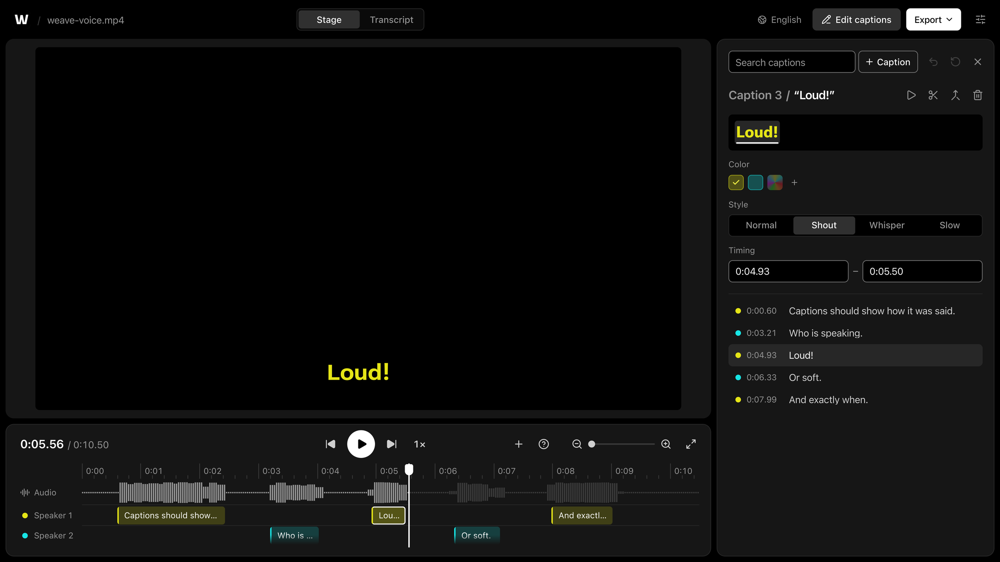

<p align="center">
  <a href="https://ailuruth.github.io/Weave/">
    <picture>
      <source media="(prefers-color-scheme: dark)" srcset="docs/figure/readme-header-dark.svg">
      
    </picture>
  </a>
</p>

<p align="center">Captions that show how it was said.</p>

<p align="center">
  <a href="#install">Install</a> &ensp;·&ensp;
  <a href="#caption-a-video">Quickstart</a> &ensp;·&ensp;
  <a href="#documentation">Documentation</a> &ensp;·&ensp;
  <a href="https://ailuruth.github.io/Weave/">Website</a>
</p>

<br>

Weave captions a video with [Caption with Intention](https://captionwithintention.org), the caption design system for Deaf and hard of hearing viewers. Each speaker gets a colour. Each word turns to that colour as it is spoken. The type grows and shrinks with the voice.

You give Weave a video. It returns the video with those captions drawn on it. It can also caption a microphone while people speak. It works in English and Korean and runs on your own machine.


The clip is from [Sprite Fright](https://studio.blender.org/films/sprite-fright/), (CC) Blender Foundation, studio.blender.org.

## Caption a video

```bash
./weave caption clip.mp4
```

Weave works out whether the speech is English or Korean. Add `--lang en`, `--lang ko` or `--lang multi` to say so yourself.

This writes the captioned video to `out/exports/`, with the captions as `.srt`, `.vtt`, an After Effects script and `.cwi.json`.

The captions are a first draft. Correct them in the studio, or edit `out/exports/clip.cwi.json` and draw the video again from it.

```bash
./weave caption clip.mp4 --captions out/exports/clip.cwi.json
./weave caption clip.mp4 --position top --size 1.2
```

The second command moves the captions to the top and makes them larger.

## Install

You need Python 3.11, Node.js, ffmpeg and Chrome, on macOS (Apple Silicon) or Linux.

```bash
git clone https://github.com/ailuruth/Weave.git
cd Weave
./install.sh
```

The script sets up everything, including 2.2 GB of models. It takes a few minutes.

## The studio

```bash
./weave live                  # captions from the microphone
./weave live --lang ko        # en, ko or multi
./weave live --sample         # the bundled film, no microphone
```



The studio opens in the browser. Choose a language to caption a microphone, or choose **Import a video** to caption a recording.

A recording plays above a timeline with one row for each speaker. Click a caption to edit it, or drag it to another row to give it to that speaker. In the editor, press a word to pick it, double click to change the text, and give it a colour and a style. **Export** saves the results.

The **?** button on the timeline lists the keys.

## Documentation

* [The project page](https://ailuruth.github.io/Weave/) has a word that follows your voice.
* [Technical notes](https://ailuruth.github.io/Weave/technical.html) explain the pipeline, the data format, recordings and the motion.
* [ARCHITECTURE.md](ARCHITECTURE.md) describes the modules and the data format.
* [CONTRIBUTING.md](CONTRIBUTING.md) has the rules for changing the code.
* [autocwi/recording/README.md](autocwi/recording/README.md) covers captioning a video.
* [web/README.md](web/README.md) covers the studio.

## Related work

Other open implementations of Caption with Intention are [opencaptions](https://github.com/broomva/opencaptions), [caption-with-intention](https://github.com/mjkang-estrella/caption-with-intention), [Alive-Caption](https://github.com/Segyun/Alive-Caption), [sightline](https://github.com/samadon1/sightline), [CIG](https://github.com/jutopia03/CIG-Caption-with-Intention-Generator-) and [Voxsama's studio](https://github.com/Voxsama/Caption-with-intention).

## License

MIT. See [LICENSE](LICENSE). Caption with Intention is authored by the Chicago Hearing Society. Weave is an independent implementation and is not affiliated with them. Bundled samples, model weights and fonts carry their own licenses.
